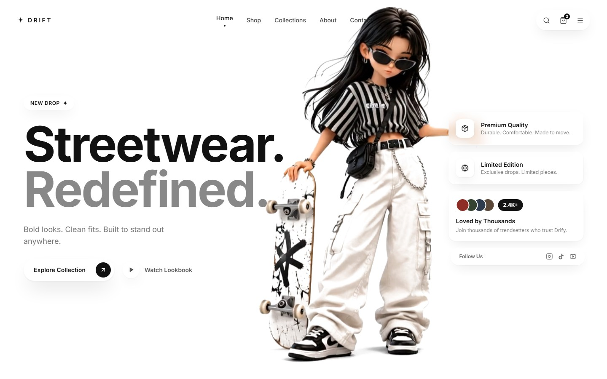

# Drift — Streetwear Storefront

Drift is a fashion storefront concept for contemporary streetwear. It brings together editorial imagery, product highlights, category sections, customer testimonials, and motion effects in a single responsive landing page.



##live link:https://drift-e-commerce-ten.vercel.app/

## Features

- Editorial hero and product showcase sections
- Popular picks, categories, featured product, and new arrivals
- Customer testimonials and responsive navigation
- Smooth scrolling and motion-led presentation
- Local product data and image, video, and screenshot assets

This repository currently contains the storefront experience. Product data is local; checkout, inventory, customer accounts, and payment processing are not connected to a backend.

## Tech stack

- [Next.js](https://nextjs.org/) 14 with the App Router
- React 18
- Tailwind CSS 3
- GSAP and Lenis for animation and smooth scrolling
- Lucide React icons

## Getting started

### Requirements

- Node.js 18.17 or newer
- npm

### Install and run locally

```bash
npm install
npm run dev
```

Open [http://localhost:3000](http://localhost:3000) in your browser.

### Production build

```bash
npm run build
npm start
```

## Available scripts

| Command | Description |
| --- | --- |
| `npm run dev` | Start the local development server |
| `npm run build` | Create a production build |
| `npm start` | Serve the production build |
| `npm run lint` | Run the configured Next.js lint command |

## Project structure

```text
app/          App Router page, layout, and global styles
components/   Storefront sections and interactive UI components
data/         Local product catalog data
lib/          Shared providers and utilities
public/       Product imagery, videos, and screenshots
```

## Updating products

Edit `data/products.js` to update the sample catalog. Product images are served from `public/`; use root-relative paths such as `/images/products/dress-1.png` in the product data.

## License

No license has been added yet. Contact the repository owner for reuse or distribution terms.
